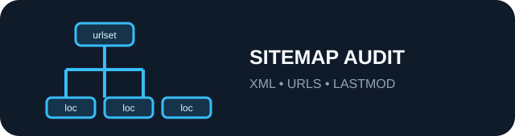

<div align="center">


[](LICENSE)

[](https://github.com/CyberLoop-dev/sitemap-xml-audit/stargazers)




</div>

## 🧭 Overview
A dependency-free Python CLI for checking local XML sitemap files and sitemap indexes. It validates entry structure, absolute HTTP(S) locations, duplicate locations, and optional `lastmod` values. It does not fetch URLs.

## ✨ Features
- 🗺️ Supports `urlset` and `sitemapindex` roots, including namespaced XML.
- 🔗 Checks absolute HTTP(S) `loc` values.
- ♻️ Finds duplicate locations.
- 🕒 Validates ISO date and date-time `lastmod` values.
- 📦 Provides text and JSON reports.

## 🖥️ Demo
The repository includes `sample-sitemap.xml`; no hosted demo is configured.

## 🚀 Quick Start
```bash
python main.py
python main.py path/to/sitemap.xml
python main.py path/to/sitemap.xml --json
python -m unittest discover -s tests
```

## 🧰 Tech Stack
- Python 3.10+
- Standard library: `xml.etree.ElementTree`, `argparse`, `urllib.parse`

## 🗂️ Folder Structure
```text
.
├── assets/mark.svg
├── tests/test_sitemap.py
├── sample-sitemap.xml
├── main.py
├── requirements.txt
└── README.md
```

## 🗺️ Roadmap
- [ ] Add optional sitemap-index file discovery without network access.
- [ ] Export CSV summaries.
- [ ] Add configurable organization-specific limits.

## 🤝 Contributing
Include a small XML fixture and the expected finding for every new validation rule.

## 📄 License
MIT. See [LICENSE](LICENSE).

<div align="center">


</div>
